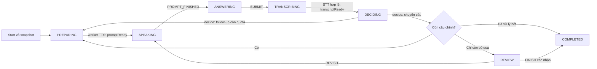

# Feature 3 — Điều phối, phòng thi FE, TTS, STT và AI hội thoại (bước 1–6)

Phạm vi hiện tại: lưu tiến trình thật, điều phối câu/lượt, thời gian, bỏ qua, retry và Finish; FE đã nối API oral, Gemini TTS, ghi âm, Groq STT và Gemini Flash-Lite quyết định follow-up/chuyển câu. Không có endpoint production cho Student tự ghi transcript hay tạo follow-up. Đây là luồng thực hiện thi, chưa phải chấm điểm Feature 4.

## Database

Migration tiến trình `docs/migrations/20261028_feature3_oral_progress.sql` đã được Ân xác nhận chạy thành công. Bước STT dùng `docs/migrations/20261029_feature3_audio_submissions.sql`; bước AI bổ sung **`docs/migrations/20261029_feature3_ai_decisions.sql`**. Trong **Supabase Dashboard → SQL Editor → New query**, dán toàn bộ file chưa chạy theo thứ tự audio trước, AI sau, bấm **Run**, đợi thành công. Không cần chạy lại file audio nếu đã áp dụng. File AI chỉ thêm ba cột claim/error nullable và index, không ghi đè câu hỏi/rubric/transcript cũ. Chương trình kiểm thử không áp dụng SQL lên database dùng chung. `AIVES_DB_POSTGRESQL_FINAL.sql` đã đồng bộ cho database khởi tạo mới; không chạy lại baseline trên database đang dùng.

| Bảng | Nội dung |
|---|---|
| `oral_exam_progress` | Bước hiện tại, revision, câu/lượt hiện tại, số follow-up, lease tab |
| `oral_question_progress` | Ngân sách chốt từ snapshot, thời gian đã dùng, trạng thái và nguyên nhân kết quả từng câu |
| `oral_exam_turns` | Câu chính/follow-up nội bộ, ngôn ngữ, transcript và thời điểm lưu |
| `oral_answer_submissions` | Công việc STT/AI, kết quả và retry theo cùng mã |
| `oral_exam_commands` | Receipt chống gửi trùng và phát hiện requestId bị dùng với payload khác |
| `transcripts` (có sẵn) | Lưu lời AI/câu trả lời theo turn; bổ sung mã oral turn/submission nullable để giữ nguyên dữ liệu cũ |

FK RESTRICT giữ bằng chứng. Bảng mới bật RLS, không cấp policy cho anon/authenticated. Không backfill snapshot/hội thoại cũ. Khi chưa migration, API oral trả `503 / code 1806`; API Feature 2 cũ tiếp tục dùng hợp đồng cũ.

## API Student

Tất cả cần JWT `ROLE_STUDENT`; service đối chiếu role hiện hành và ownership trong DB. `{id}` là **StudentExam ID**, không phải ExamSession ID.

| Method | Đường dẫn | Mục đích |
|---|---|---|
| GET | `/oral-examination/runtime` | LIVE/true khi đủ cấu hình ba dịch vụ và migration; thiếu thì FOUNDATION/false |
| POST | `/oral-examination/speech-preview` | Nhận `{language: "vi" hoặc "en"}`, trả WAV mẫu cố định, không mở exam |
| POST | `/student-exams/{id}/oral-examination/speech` | Nhận clientSessionId/turnId/expectedRevision, chỉ trả WAV của lượt snapshot hiện tại |
| POST | `/oral-examination/transcription-preview` | Multipart `language=vi/en` và `audio`; thử micro/STT, không ghi lịch sử thi |
| POST | `/student-exams/{id}/oral-examination/submissions/{job}/audio` | Multipart `metadata` JSON clientSessionId/turnId và `audio`; 202 xác nhận nhận file, STT xử lý nền |
| POST | `/student-exams/{id}/oral-examination` | Gọi Start Feature 2, chốt snapshot rồi mở/đọc lại hội thoại |
| GET | `/student-exams/{id}/oral-examination` | Đọc tiến trình và transcript của chính Student; đồng bộ timeout đã xảy ra |
| POST | `/student-exams/{id}/oral-examination/actions` | Ra lệnh có revision, turnId và requestId |
| POST | `/student-exams/{id}/oral-examination/lease` | Giữ quyền bằng clientSessionId, không phụ thuộc revision/turn hoặc ghi lại hội thoại |

Body mở:

```json
{"clientSessionId":"11111111-1111-4111-8111-111111111111"}
```

Body thao tác (lấy `expectedRevision` và `turnId` từ response mới nhất):

```json
{
  "requestId":"22222222-2222-4222-8222-222222222222",
  "clientSessionId":"11111111-1111-4111-8111-111111111111",
  "expectedRevision":1,
  "turnId":"33333333-3333-4333-8333-333333333333",
  "action":"PROMPT_FINISHED"
}
```

`action`: `PROMPT_FINISHED`, `REPLAY`, `DEFER`, `REVISIT`, `SUBMIT`, `PAUSE`, `RESUME`, `RETRY`, `FINISH`, `HEARTBEAT`. Chỉ `REVISIT` có thêm `targetQuestionOrder`; ở REVIEW, `turnId` là null theo response. Trường ngoài hợp đồng bị từ chối. Mỗi thao tác dùng requestId mới; retry lỗi mạng dùng **nguyên payload**. Retry thành công trả tiến trình hiện tại, không tạo thêm hiệu ứng.

Lease tab là 45 giây; FE gọi `/lease` mỗi 10 giây khi tab đang hiển thị và đã nhận quyền. Request giữ quyền độc lập GET/audio, không tạo pending nghiệp vụ hoặc phụ thuộc revision/turn. Heartbeat không tăng revision và không gia hạn slot/ngân sách. Tab khác chỉ takeover sau khi lease hết hạn bằng mở hội thoại hoặc RESUME. GET thường chỉ đọc snapshot nhất quán, không khóa/ghi lại aggregate; chỉ khi có timeout thật mới vào đường ghi có khóa. Thời gian hết trước lệnh thì BE trả trạng thái mới, không áp lệnh cũ vào câu kế tiếp.

Response không chứa nội dung câu hỏi, danh sách đề, đáp án hoặc rubric. Chỉ có metadata câu hiện tại, tiến độ và transcript Student. FE dùng API oral. **Khi `ORAL_AI_ENABLED=true`, POST `/student-exams/{id}/starts` cũ bị chặn bằng 409/code 1801**; Student vào route oral để nghe từng câu. Lượt đã có oral progress vẫn bị chặn đường cũ kể cả tạm tắt flag. Start nội bộ vẫn giữ nguyên business rules Feature 2.

Heartbeat tới sau khi chốt bài/hết slot trả `terminal=true, leaseUntil=null`; FE đọc kết quả cuối, không coi đây là tab khác giành quyền. Xung đột quyền khi bài còn hoạt động vẫn trả 1803.

STT và AI được đánh thức ngay **sau commit**, scheduler 2 giây chỉ còn phục hồi khi restart/worker bận. Mỗi turn mới chỉ chuẩn bị audio của câu hiện tại vào cache hữu hạn; không xác nhận SPEAKING hoặc mở giờ trả lời trước khi Student phát audio. Yêu cầu nghe vẫn kiểm tra quyền/turn/deadline trước và sau mạng; cache gộp lời gọi trùng. FE đọc tiến trình mỗi 800 ms khi chờ xử lý, 3 giây ở các bước khác, không chồng GET. Log `oral-stt`, `oral-ai`, `oral-tts` có `providerMs` để đo độ trễ dịch vụ thật, không ghi nội dung trả lời/đề hoặc key. Các tối ưu này không cần migration hoặc đổi model.

## Luồng và callback nội bộ



Các hàm `promptReady`, `transcriptReady`, `decide`, `technicalFailure` của `OralExamService` chỉ dành cho dịch vụ tin cậy. **Không có HTTP callback public hoặc provider giả trong production.** Khi FE yêu cầu speech, BE lấy prompt trong transaction ngắn, gọi TTS bên ngoài transaction rồi xác thực lại ownership/lease/turn/deadline trước khi xác nhận SPEAKING. Khi Student bấm Trả lời xong, FE lưu Blob vào IndexedDB trước, gửi `SUBMIT` dành mã công việc rồi upload đúng audio cho mã đó. Worker nhận claim ngắn, gọi Groq ngoài transaction, sau đó kiểm tra lại claim/turn/deadline trước khi chốt transcript. Transcript hợp lệ chuyển sang `DECIDING`; worker AI lấy claim riêng, gọi Gemini ngoài transaction rồi chốt đúng một follow-up hoặc chuyển câu. BE áp quota/thời gian và lưu lời AI cùng quyết định trong transaction; hết slot thắng mọi callback về muộn.

`promptReady` nhận ngôn ngữ `vi`/`en` đã xác định cho câu chính. Follow-up kế thừa ngôn ngữ này. Snapshot không bị dịch hoặc sửa. Worker TTS sau này đọc lời dẫn “Câu số … / Question number …” và đúng prompt của turn hiện tại.

## Thời gian và kết thúc

- Số câu chính/giới hạn follow-up lấy từ phiên thi. Ngân sách mỗi câu lấy từ `snapshot_answer_time_limit_seconds`, dùng chung cho câu chính và follow-up. Null giữ ý nghĩa không có giới hạn riêng, vẫn chịu hạn slot.
- Chỉ trừ ngân sách khi ANSWERING, kể cả im lặng; PREPARING/SPEAKING/STT/AI không trừ ngân sách câu nhưng thời hạn slot luôn chạy. Replay, refresh, pause, retry và takeover không đặt lại thời gian đã dùng.
- Chỉ DEFER câu chính chưa trả lời; sau lượt đầu vào REVIEW mới được quay lại. Không sửa lại câu đã trả lời.
- STT rỗng quay về cùng lượt, không tạo transcript. “Em không biết” có nội dung vẫn là câu trả lời. Lỗi kỹ thuật vào TECHNICAL_ERROR và retry cùng công việc.
- STT/AI chờ quá 90 giây sẽ thành lỗi kỹ thuật (1811/1816), hủy claim cũ để callback trễ không thắng lần retry. Giữ nguyên audio/transcript đã nhận; RETRY bắt đầu mốc chờ mới, không cộng thời gian câu/slot. Worker gặp tranh khóa lúc chốt sẽ thử lại chính kết quả trong RAM tối đa ba lần, không gọi provider thêm chỉ vì xung đột ngắn.
- Hết ngân sách khi đang trả lời: lưu NO_ANSWER nếu chưa có câu trả lời chính; nếu đã trả lời chính thì giữ ANSWERED, ghi rõ follow-up chưa trả lời. Không tạo transcript rỗng/điểm giả.
- FINISH ở REVIEW xác nhận các DEFERRED thành NO_ANSWER với lý do SUBMITTED_UNANSWERED. Tự hoàn thành khi đủ kết quả tất cả câu. Finish cũ không được bỏ qua follow-up hoặc công việc chưa xong của tiến trình oral.
- Hết slot/Close: EXPIRED, không đặt completedAt hoặc điểm. Giữ bằng chứng, nguyên nhân NOT_REACHED/DEFERRED_AT_DEADLINE/SLOT_EXPIRED/TECHNICAL_ERROR. Feature 4 phải đọc nguyên nhân này, không mặc định mọi thiếu transcript là 0 điểm.
- Thời gian được đồng bộ khi có request/callback; hiện chưa có job nền tự cập nhật trạng thái khi hoàn toàn không có request. Close phiên vẫn xử lý EXPIRED theo Feature 2.

## Phòng thi FE nối API

Trong My Exams, “Bắt đầu thi / Tiếp tục bài thi” dẫn đến `/student/exams/{studentExamId}/oral`. Mở trang chỉ GET; xác nhận mới POST mở lượt. FE hiển thị metadata và transcript Student, không hiển thị đề/đáp án/rubric. Heartbeat riêng mỗi 10 giây; poll cách lần đọc trước hoàn tất 3 giây để không dồn request khi DB chậm. Reload giữ UUID tab và payload đang chờ trong sessionStorage; lỗi mạng không đổi requestId để gửi lại. Nếu BE đã xác nhận SUBMIT cũ bị từ chối bằng 1802 và vẫn chờ đúng turn, FE mới lấy revision mới, tạo requestId mới và gửi nguyên Blob đã giữ; không gắn bản ghi sang câu khác. Tab nhân bản trao đổi BroadcastChannel để tránh dùng cùng UUID.

Backend trả `LIVE / providersReady=true` khi TTS, STT, AI đã bật/có cấu hình và hai migration audio/AI đã sẵn sàng; thiếu thì `FOUNDATION / false` và FE chặn bắt đầu mới. Các cờ chỉ xác nhận cấu hình, không chứng minh key hợp lệ/còn quota. Tiến trình đã mở vẫn đọc/phục hồi được. Không bật mock trên Supabase. Bước 3–4 không đổi schema; **bước 5 cần migration audio, bước 6 cần migration AI** nêu trên.

Để thử trọn luồng cục bộ, mở Docker Desktop và hai terminal riêng:

**Terminal BE**, trong `avies-backend` (JDK 21):

```powershell
mvn -DskipTests test-compile exec:java '-Dexec.mainClass=com.avies.backend.exam.OralExamBrowserDemo' '-Dexec.classpathScope=test' '-Dexec.cleanupDaemonThreads=false'
```

Đợi `ORAL DEMO READY`. Chương trình trong `src/test` tạo PostgreSQL container mới, tự áp migration và seed bốn lượt mẫu; chỉ lắng nghe `127.0.0.1:8081`. Không đọc `.env`, không dùng tài khoản thật và không đóng gói vào JAR production. Dừng bằng Ctrl+C sẽ dọn container.

**Terminal FE**, trong `aives-frontend`:

```powershell
$env:VITE_API_BASE_URL='http://127.0.0.1:8081'
npm.cmd run dev -- --host 127.0.0.1 --port 5174 --strictPort
```

1. Mở `http://127.0.0.1:5174/signin`, đăng nhập `student / oral-demo`. Đây là tài khoản fixture, không phải account dự án.
2. Vào **My Exams**, chọn lượt **Demo liên thông FE–BE**, xác nhận thử cục bộ rồi bắt đầu.
3. Bấm **Đã nghe lượt mẫu** (chưa có audio), chọn tình huống ở bên phải rồi **Trả lời xong**. Thử nhánh ngắn → follow-up, rõ → chuyển câu, rỗng → cùng lượt, lỗi kỹ thuật → thử lại. Transcript mẫu do worker BE lưu trong PostgreSQL riêng.
4. Thử tạm bỏ qua, quay lại sau lượt đầu, reload và tiếp tục; đồng hồ/turn không được đặt lại. Lượt “10 giây” dùng để thử NO_ANSWER khi im lặng. Finish câu bỏ qua có popup xác nhận; hoàn tất mọi câu được BE chốt tự động.
5. Đăng nhập lại chỉ làm mới lịch các fixture CHƯA bắt đầu, không gia hạn lượt đang thi. Restart chương trình BE tạo DB mới để thử lại từ đầu. Dashboard profile có thể báo 404 vì test server chỉ cung cấp API cần cho thi; vào My Exams để thử.

Mở terminal mới khi quay lại FE/BE thông thường để không giữ biến môi trường API demo. Route `/student/exams/oral-preview` vẫn là bản mô phỏng FE độc lập, không ghi database. API Start cũ chỉ dùng cho lượt legacy khi chưa bật oral; không dùng nó để thử thi giọng nói.

## Bật giọng đọc thật (bước 4)

1. Tạo API key Gemini trong [Google AI Studio](https://aistudio.google.com/api-keys). Dùng project có quyền sử dụng Gemini TTS và kiểm tra hạn mức Free Tier. Không gửi key vào chat hoặc đưa vào VITE/frontend.
2. Trong `.env` của **avies-backend**, thêm các dòng sau, tự thay giá trị key (không đặt trong dấu nháy vì project import `.env` theo Java properties):

```properties
ORAL_TTS_ENABLED=true
GEMINI_TTS_API_KEY=THAY_BANG_KEY_THAT_CUA_BAN
GEMINI_TTS_MODEL=gemini-3.8-flash-tts
GEMINI_TTS_VOICE=Kore
```

3. Dừng rồi Run BE thông thường, chạy FE thông thường. Đăng nhập **Student → My Exams → Bắt đầu thi** của một lượt được phân công: trang chuẩn bị có **Kiểm tra giọng đọc**, chọn Việt/Anh rồi **Nghe thử giọng đọc**. Chỉ mở trang/nghe mẫu không bắt đầu lượt thi. Nếu browser chặn autoplay, bấm **Phát giọng đọc**. Không cần cài giọng tiếng Việt của Windows.
4. Lượt oral đã mở và còn slot: bấm **Tiếp tục / nhận lại quyền → Nghe câu hỏi**. BE đọc “Câu số n” hoặc “Question number n”, rồi prompt đã snapshot. Audio kết thúc mới gửi PROMPT_FINISHED và bắt đầu ngân sách trả lời. Các lượt kế tiếp tự phát sau lần bấm nghe đầu tiên nếu browser cho phép. Refresh không tự bật audio; Student chủ động nhận lại quyền/nghe lại.

Khi chưa bật đủ pipeline, FE chặn mở lượt mới; **đừng tạo lượt thi thật chỉ để thử thiết bị**. Dùng mẫu cố định để kiểm tra key/loa. Demo Docker ở phần trước không gọi Google/Groq và không phát giọng thật.

Audio qua REST có bearer, `Cache-Control: no-store`; không có URL public hoặc nội dung đề trong JSON. Cache RAM tối đa 16 entries/32 MiB trong 20 phút, gộp request cùng turn; nghe lại không tăng follow-up hoặc cấp lại thời gian. Restart/eviction cache có thể cần tổng hợp lại; snapshot văn bản vẫn giữ nguyên. Không lưu audio lâu dài hoặc thay schema ở bước này.

TTS tự đọc ngôn ngữ trong văn bản; lời dẫn hiện chọn vi khi câu snapshot có dấu tiếng Việt, còn lại en; follow-up kế thừa ngôn ngữ câu chính. Với câu tiếng Việt không dấu hoặc nội dung trộn ngôn ngữ, nên chuẩn hóa ngân hàng; chưa có trường language riêng trong schema để phân biệt chắc chắn các trường hợp này.

Lỗi: `1807 / 503` chưa bật/key/cấu hình bị từ chối; `1808 / 502` mạng/timeout/WAV sai; `1809 / 429` quota/bận. Không ghi lỗi thô của provider ra log/response, không âm thầm fallback sang giọng khác hoặc ghi transcript giả. Có thể tắt TTS bằng `ORAL_TTS_ENABLED=false` rồi restart BE.

Provider dùng [Gemini Interactions TTS REST](https://ai.google.dev/gemini-api/docs/speech-generation), WAV PCM mono 24kHz/16-bit. Model mặc định có Free Tier theo [bảng giá Gemini](https://ai.google.dev/gemini-api/docs/pricing); quota và quyền truy cập phụ thuộc project. Kiểm thử tự động chỉ dùng HTTP stub, không xác nhận chất lượng giọng/khả dụng của key thật.

## Bật micro và nhận dạng thật (bước 5)

1. Mở [GroqCloud API Keys](https://console.groq.com/keys), đăng ký/đăng nhập tài khoản. Chọn **Create API Key**, đặt tên như `aives-feature3-stt`, tạo rồi sao chép key vào máy của bạn. Key này riêng với Gemini, không gửi vào chat/Git/frontend. Xem [Groq Quickstart](https://console.groq.com/docs/quickstart).
2. Trong `.env` của **avies-backend**, thêm (không bọc giá trị bằng dấu nháy):

```properties
ORAL_STT_ENABLED=true
GROQ_API_KEY=THAY_BANG_KEY_GROQ_CUA_BAN
GROQ_STT_MODEL=whisper-large-v3-turbo
```

3. Áp dụng **migration audio mới** ở mục Database, rồi restart BE và FE như bình thường. Không thay cấu hình Gemini TTS đang hoạt động.
4. Đăng nhập **Student → My Exams → Bắt đầu thi/Tiếp tục bài thi** để vào trang chuẩn bị của lượt được phân công. Trong **Kiểm tra micro và nhận dạng**, chọn Việt/Anh, bấm **Bật micro và ghi thử** và cho phép browser sử dụng micro. Nói một câu rõ ràng, bấm **Ghi xong · Nhận dạng thử** để xem transcript chỉ đọc. Preview ghi tối đa 15 giây, không bắt đầu lượt thi, không lưu audio/transcript vào database. Dùng Chrome/Edge trên localhost hoặc HTTPS; không thử STT trong lúc đang phát mẫu TTS.
5. Tiến trình oral đã mở và còn slot: nhận lại quyền, nghe câu hỏi; khi sang `ANSWERING`, chủ động bật micro lần đầu. Các lượt tiếp theo chỉ tự mở micro sau khi Student đã cho phép ở lần đầu và AI đọc xong. Bấm **Trả lời xong** trước hạn: upload → `TRANSCRIBING` → transcript thật → `DECIDING` → hỏi thêm/chuyển câu khi đã bật bước 6 bên dưới.

Groq dùng [Speech-to-Text](https://console.groq.com/docs/speech-to-text) với `whisper-large-v3-turbo`, hỗ trợ Việt/Anh; endpoint transcription giữ ngôn ngữ câu trả lời. Không gửi reference answer/prompt gợi đáp án cho STT. Free Tier có [hạn mức](https://console.groq.com/docs/rate-limits), không phải miễn phí không giới hạn; kiểm tra Limits của tài khoản khi demo. Không cần cài thêm SDK vào FE.

### Bản ghi, retry và lưu trữ

- Mỗi bản ghi tối đa **5 phút / 8 MiB**; preview tối đa 2 MiB. Thời gian còn lại của câu/slot vẫn là giới hạn cao hơn. Định dạng từ MediaRecorder: WebM/Opus, Ogg/Opus hoặc MP4 tùy browser; BE cũng nhận WAV và kiểm tra header/MIME/hash.
- Chưa bấm Trả lời xong mà refresh/rời trang/pause/nghe lại: bản ghi chưa gửi bị bỏ, không tạo transcript giả. Khi hết giờ, browser dừng micro; BE giữ quy tắc NO_ANSWER/EXPIRED đã có, không tự coi lỗi kỹ thuật là 0 điểm.
- Sau khi bấm Trả lời xong, Blob được giữ trong IndexedDB theo backend/user/lượt thi/tab trước khi SUBMIT. Nếu mạng lỗi hoặc refresh, nhận lại quyền rồi dùng **Gửi lại bản ghi đang chờ**; dùng nguyên requestId/Blob/job. BE nhận file xong mới xóa bản local. Không thay bytes của submission đã nhận bằng bản ghi mới. Transcript đã chốt không sửa bằng textbox.
- BE mặc định giữ file riêng tại `private/oral-audio` (đã gitignore), có thể đổi bằng `ORAL_AUDIO_DIRECTORY`. Không nằm trong static/public/uploads và không có API tải công khai. Giữ nguyên thư mục này, gồm `.storage-id`, qua restart. Hiện chưa tự xóa raw audio; khi triển khai cần thống nhất thời hạn lưu/dọn sau khi không còn job cần phục hồi.
- Job gắn định danh vùng lưu audio: các thành viên dùng chung Supabase nhưng chạy BE trên máy khác không lấy nhầm file của nhau. Máy BE đã nhận audio cần hoạt động để xử lý; muốn nhiều BE cùng phục hồi job thì cấu hình **volume lưu trữ riêng dùng chung**, giữ cùng `.storage-id`. Sao chép code/DB không tự sao chép audio. Mất vùng lưu audio là lỗi kỹ thuật, không phải câu trả lời rỗng.
- Worker có thể gọi Groq lại sau crash/claim hết hạn; kết quả transcript chỉ được chốt một lần theo submission/claim/turn. Không giữ transaction khi gọi mạng. Retry lỗi provider dùng cùng job; file đã nhận vẫn được giữ.
- Im lặng bị phát hiện ở browser/provider thì không tạo câu trả lời giả. “Em không biết” là câu trả lời thật. Ngưỡng phát hiện tiếng nói/độ tin cậy có thể từ chối bản ghi quá nhỏ tiếng hoặc nhiều nhiễu; cần thử microphone thật, không bảo đảm STT chính xác tuyệt đối.

Mã lỗi STT: `1810 / 503` chưa bật hoặc key/cấu hình không hợp lệ; `1811 / 502` mạng/nhận dạng/metadata lỗi; `1812 / 429` quota/bận; `1813 / 400` audio không hợp lệ; `1814 / 409` cố thay audio đã chốt. UI hiện tiếng Việt, không lộ lỗi thô/key của provider. Có thể tắt bằng `ORAL_STT_ENABLED=false` rồi restart BE.

## Bật AI hội thoại và thử trọn bài (bước 6)

1. Chạy migration **AI mới** trong mục Database (và migration audio nếu chưa chạy).
2. Thêm vào `.env` của **avies-backend**, không bọc giá trị bằng dấu nháy:

```properties
ORAL_AI_ENABLED=true
GEMINI_ORAL_API_KEY=KEY_GEMINI_HOP_LE_CUA_BAN
GEMINI_ORAL_MODEL=gemini-3.5-flash-lite
```

Không bắt buộc tạo key mới: có thể dùng cùng giá trị key Gemini đang chạy TTS nếu project cho phép model text. Nếu không khai báo `GEMINI_ORAL_API_KEY`, BE thử dùng `GEMINI_API_KEY`; không đổi cấu hình Feature 1. Model Flash-Lite hiện hỗ trợ structured output và Free Tier theo [tài liệu model](https://ai.google.dev/gemini-api/docs/models/gemini-3.5-flash-lite) / [bảng giá](https://ai.google.dev/gemini-api/docs/pricing#gemini-3.5-flash-lite); quota/quyền truy cập phụ thuộc project, không cam kết miễn phí vô hạn.

3. Giữ cấu hình TTS và Groq STT đã thử thành công. Restart BE, FE; đăng nhập Student → My Exams → mở phòng của lượt **chưa thi, đang trong slot**. Kiểm tra thiết bị rồi bấm **Bắt đầu lượt thi**. Nếu vẫn bị khóa, xem GET `/oral-examination/runtime`: cần `mode=LIVE`, `providersReady=true`; thiếu migration/key/flag thì chưa mở.
4. Bấm **Nghe câu hỏi** lần đầu, AI nói “Câu số 1/Question number 1” rồi đọc snapshot. Bật mic, trả lời, bấm **Trả lời xong**. Transcript được lưu trước, AI mới đề xuất bước sau. Nếu cần làm rõ, BE tạo một follow-up cùng ngôn ngữ rồi TTS đọc; trả lời follow-up xong mới xét tiếp. Khi không cần hỏi thêm hoặc đã hết quota/ngân sách, sang câu chính tiếp theo. Browser có thể yêu cầu bấm phát nếu chặn autoplay.
5. Thử **Tạm bỏ qua** trước khi trả lời câu chính; sau lượt đầu quay lại các câu đó, giữ ngân sách còn lại. Hoàn tất các câu thì hệ thống chốt `COMPLETED`; nếu còn câu bỏ qua, Student xác nhận nộp hoặc quay lại trả lời. Hết slot vẫn `EXPIRED`, không cộng thời gian do chờ AI. Feature 4 mới chấm điểm.
6. Khi AI lỗi/quota, transcript không bị xóa hoặc nhận dạng lại; nút **Thử lại lượt xử lý** dùng cùng submission. Không tự ADVANCE giả. Tắt flag để bảo trì không mở đường Start cũ lấy đề của lượt đã có oral progress.

AI chỉ nhận câu chính snapshot và tối đa tám lượt hỏi/đáp gần nhất của cùng câu, không nhận reference answer/rubric, ID Student hoặc toàn bộ danh sách đề. System instruction tách khỏi transcript không tin cậy; response bắt buộc JSON `ADVANCE/FOLLOW_UP`, BE kiểm tra hình dạng, độ dài, ngôn ngữ, câu trùng, nội dung bị cấm và quota trước khi lưu. Không coi các kiểm tra cấu trúc này là bảo đảm tuyệt đối về chất lượng/ngữ nghĩa AI; cần nghe thử dữ liệu môn thực tế trước demo. Follow-up là **tối đa toàn bài**, không bắt buộc AI phải dùng hết.

Claim AI sống 60 giây, worker phục hồi sau restart; không phụ thuộc tab/máy đang giữ audio vì transcript đã nằm trong DB. Hai worker không chốt hai quyết định; sau crash có thể gọi provider lại nhưng chỉ một kết quả đúng nonce được commit. Lỗi `1815/503`: cấu hình/key/model; `1816/502`: mạng/timeout/JSON hoặc prompt không hợp lệ; `1817/429`: quota/bận. UI hiện tiếng Việt, không lộ lỗi thô hoặc âm thầm dùng dịch vụ mẫu.

## Kiểm thử

```powershell
mvn test
mvn verify -Ppostgres-it '-Dtest=GeminiOralDecisionProviderTest,OralDecisionWorkerTest' '-Dit.test=OralExamPostgresIT,ExamLifecyclePostgresIT'
```

PostgreSQL do Testcontainers tạo và dọn, không nạp application.yaml/.env hoặc truy cập Supabase/AI. Kiểm thử gồm migration lặp, quyền/ownership, snapshot, timer, lease, idempotency, callback lặp/quá hạn, bỏ qua/quay lại, kết thúc, rollback, FK/RLS, khóa đồng thời, upload lặp/đổi bytes, job phục hồi, vùng lưu audio khác máy, lỗi/quota STT/AI, JSON không hợp lệ và giới hạn follow-up. Có test HTTP audio → STT worker → AI worker → follow-up → câu tiếp theo → Finish, dùng provider stub. FE kiểm tra hợp đồng LIVE, mã lỗi Việt hóa, multipart/response, microphone cleanup và permission về trễ. Người dùng đã xác nhận TTS và STT Việt/Anh hoạt động; tích hợp AI bước 6 cần thử tiếp bằng key thật, kiểm thử tự động không gọi Google/Groq thật.
